# StockSim

A paper-trading stock app for iOS, built with **UIKit** and **Clean Swift (VIP)** — no third-party dependencies.

> **Disclaimer:** Educational project. No real money is involved. Prices are simulated, or delayed real data in developer builds. The distributed (TestFlight) build uses fictional companies only. Nothing here is investment advice.

<p align="center">
  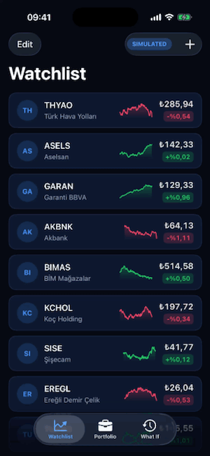
</p>

| Watchlist | Detail | Candles + crosshair | Trade |
|---|---|---|---|
| 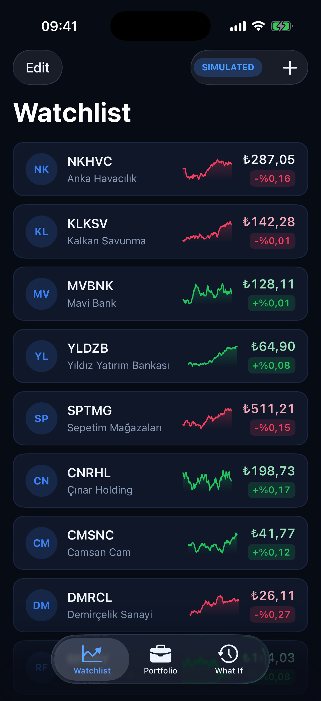 | 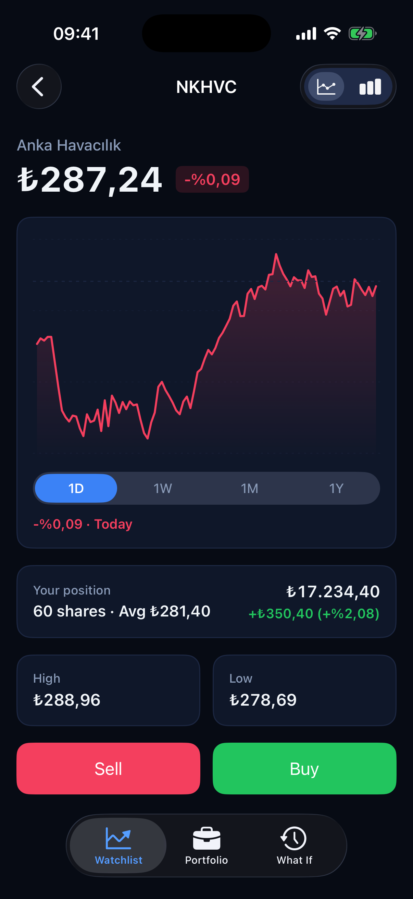 | 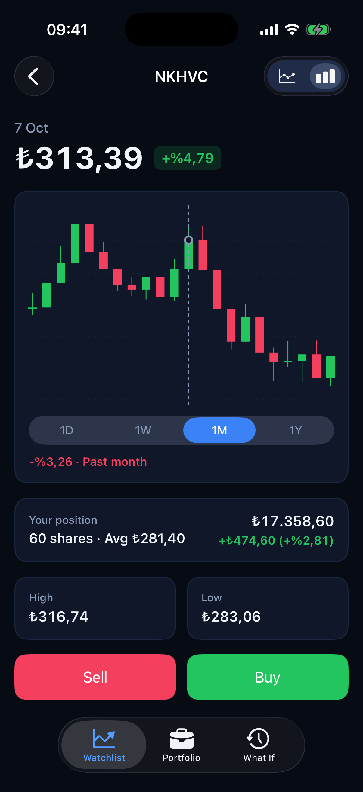 | 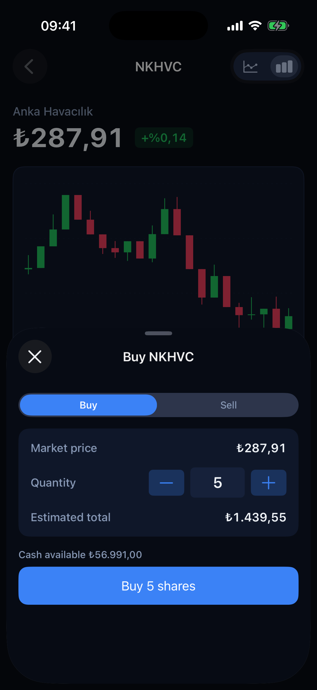 |

| Portfolio | What If | Scenario | Search |
|---|---|---|---|
| 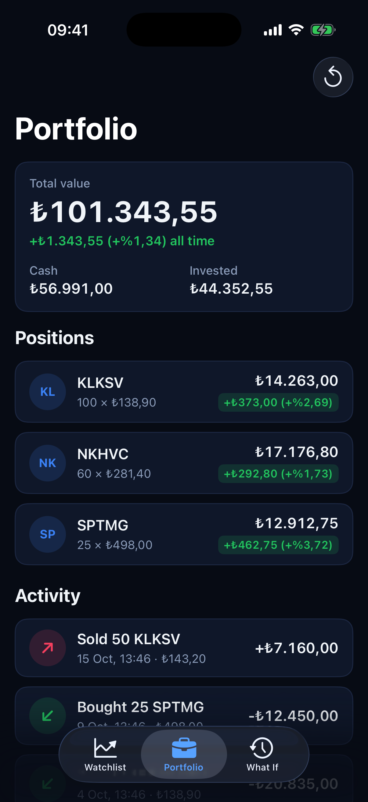 | 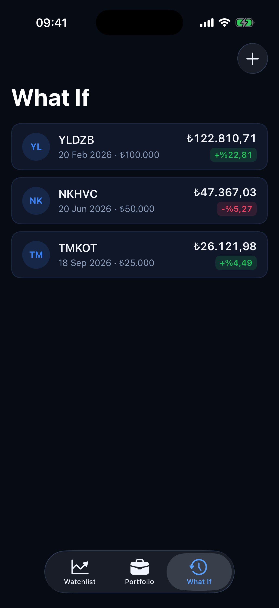 | 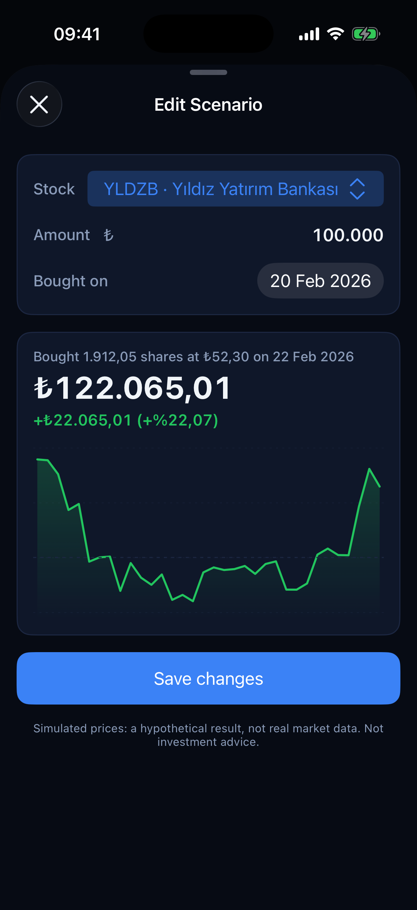 | 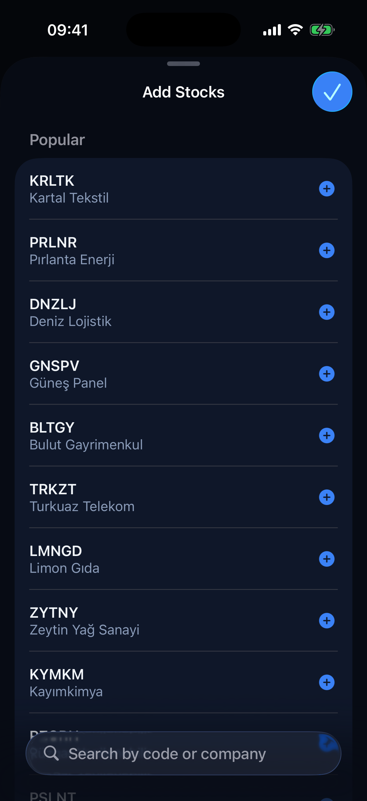 |

**Edge cases** — triggered from the in-app market controls; every screen reacts through the normal price stream:

<p align="center">
  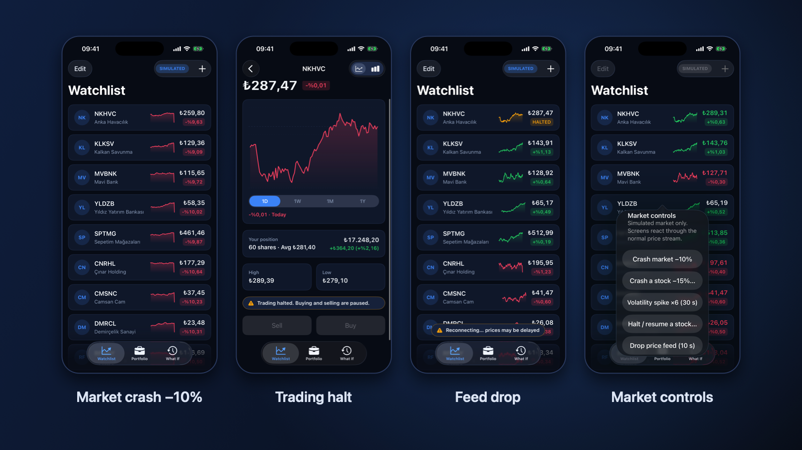
</p>

| First launch | Open source |
|---|---|
| 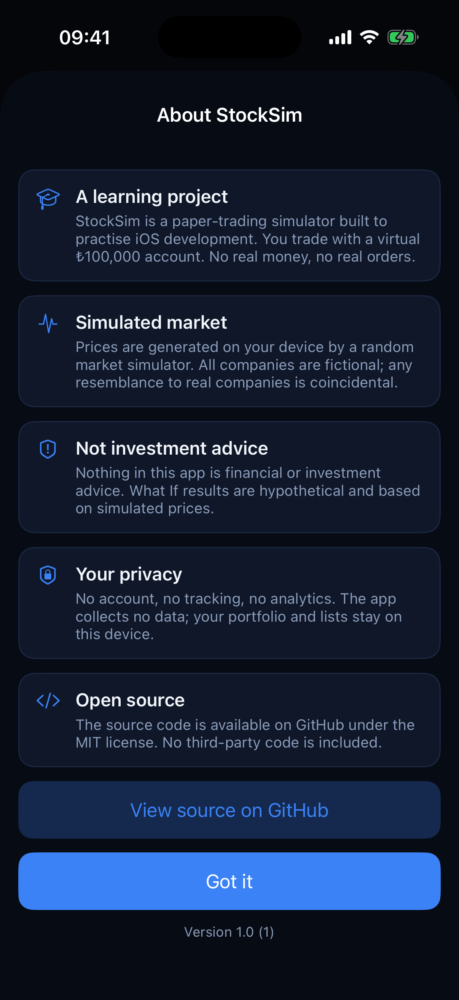 | 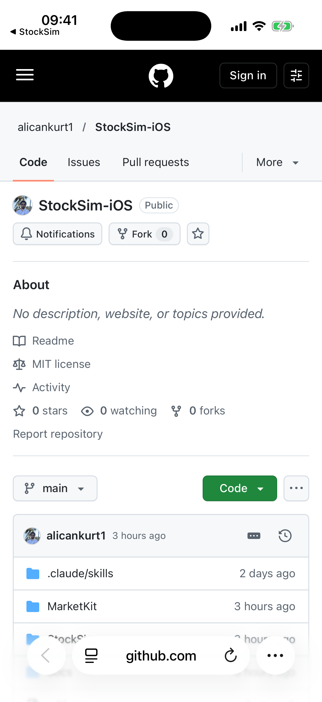 |

Screenshots show the distribution build: fictional companies, simulated prices (`-distribution -demoData`).

## Features

- **Watchlist** — live prices, daily change and sparklines; search, add, remove and reorder (Borsa Istanbul tickers in developer builds, fictional companies in the distribution build)
- **Stock detail** — line and candlestick charts drawn by hand (Core Graphics / Core Animation), 1D · 1W · 1M · 1Y, crosshair with haptics, live position card
- **Trading** — buy / sell with 100,000 TRY of virtual cash; insufficient cash / quantity and trading-halt rules
- **Portfolio** — total value, all-time P&L, positions and trade history, saved on device
- **What If** — "what if I had invested ₺100,000 on this date?" scenarios, tracked over time and editable
- **Market simulator** — deterministic geometric Brownian motion with edge-case triggers: crash, volatility spike, trading halt, feed drop (shake the device to open market controls)
- **Real data (developer builds)** — delayed BIST data behind the same protocol as the simulator
- **Distribution build** — TestFlight public beta: simulator only, fictional companies, no network, no data collected ([details](docs/TESTFLIGHT.md), [privacy](PRIVACY.md))

## Architecture

```
StockSim (app)                           MarketKit (local Swift package)
┌──────────────────────────────┐         ┌──────────────────────────────────┐
│ Scenes (Clean Swift / VIP)   │         │ Domain        models, rules,     │
│  VC → Interactor → Presenter │ ──────▶ │               stores (actors)    │
│  Router + DataStore, Worker  │         │ MarketSimulator  GBM, triggers   │
│ Composition root             │         │ MarketData       HTTP provider   │
│  AppAssembler                │         │ Persistence      JSON files      │
│ Design system (Theme, cells) │         │ Charts           scales, views   │
└──────────────────────────────┘         └──────────────────────────────────┘
```

- **Clean Swift (VIP):** each screen is a one-way cycle — the view controller sends requests to the interactor (business rules), the interactor sends raw domain data to the presenter (formatting, no UIKit), the presenter sends view models back to the view controller. Routers pass data between scenes through data stores.
- **SOLID in practice:** small protocols per layer (ISP), concrete types only in the composition root (DIP), the simulator and the real-data provider are interchangeable (LSP), new chart types and order types are added without touching existing code (OCP).
- **Concurrency:** Swift 6 strict concurrency; shared state in actors (market simulator, portfolio, watchlist); live prices as `AsyncStream`.
- **Charts:** pure geometry (scales, candle layout, binary-search hit testing) tested on macOS; views draw with `CAShapeLayer` and `draw(_:)` where each fits best.

## Performance

120 symbols × 10 updates/s (1,200 price updates/s), measured with Instruments on the simulator:

| | Before | After |
|---|---|---|
| Watchlist applies / s | 1,160 | 10.9 |
| Main thread CPU | 57.9 % | 11.3 % |

Updates are coalesced per frame and only the latest price per symbol is applied. Details: [docs/PERFORMANCE.md](docs/PERFORMANCE.md).

## Tests

Swift Testing throughout — domain rules as table-driven tests, interactors with presenter spies and worker stubs, presenters with display spies, routers for data passing, persistence on real files in temporary directories, network code with fixtures (tests never hit the network).

```bash
swift test --package-path MarketKit
```

```bash
xcodebuild test -project StockSim/StockSim.xcodeproj -scheme StockSim -destination 'platform=iOS Simulator,name=iPhone 17'
```

## Running

Open `StockSim/StockSim.xcodeproj` and run. Useful launch arguments:

| Argument | Effect |
|---|---|
| `-stressTest` | 120 generated symbols at 10 Hz |
| `-noBatching` | Disable per-frame batching (for comparison) |
| `-slowLoading` | Delay loading to preview skeletons |
| `-realData` | Start with delayed real data |
| `-inMemoryStorage` | Do not read or write saved data |
| `-demoData` | Seeded demo account and scenarios (in memory), used for screenshots |
| `-distribution` | Behave like the TestFlight build: fictional companies, simulator only (in memory) |
| `-showWelcome` | Show the first-launch About sheet on every launch (for screenshots) |

## Progress

| Phase | Topic | Status |
|---|---|---|
| 0 | Foundation | ✅ Done |
| 1 | Domain (TDD) | ✅ Done |
| 2 | Market simulator | ✅ Done |
| 3 | Watchlist scene (VIP) | ✅ Done |
| 4 | Sparkline | ✅ Done |
| 5 | Stock detail + line chart | ✅ Done |
| 6 | Candlestick + crosshair | ✅ Done |
| 7 | Trading | ✅ Done |
| 8 | Portfolio, history, persistence | ✅ Done |
| 9 | Real market data | ✅ Done |
| 9.5 | Stock search + personal watchlist | ✅ Done |
| 10 | What-if tracker | ✅ Done |
| 11 | Edge cases in the app | ✅ Done |
| 12 | Performance | ✅ Done |
| 13 | Polish & publish | ✅ Done |
| 14 | TestFlight public beta | 🚧 Build ready, upload postponed |

See [PLAN.md](PLAN.md) for the full plan and [NOTES.md](NOTES.md) for learning notes (Turkish).

## License

[MIT](LICENSE). Market data in developer builds comes from an unofficial endpoint and is for development only; distributed builds use the simulated market.
